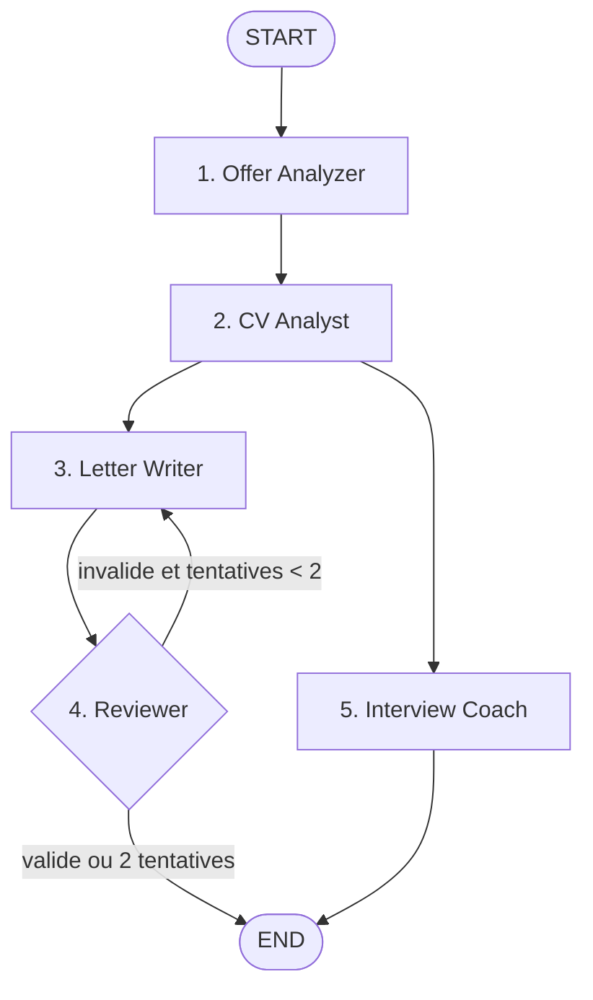

# Architecture

## Vue d'ensemble



## Orchestration

- **Séquentiel** : le CV Analyst a besoin de l'analyse de l'offre, il attend donc l'Offer Analyzer.
- **Parallèle** : après le CV Analyst, l'Interview Coach et la boucle Writer ↔ Reviewer sont indépendants et s'exécutent en même temps.
- **Boucle conditionnelle** : si le Reviewer invalide la lettre et que `attempts < 2`, retour au Writer avec la liste des problèmes. Sinon, fin.

## État partagé

Défini dans `src/alternance_copilot/state.py`.

```python
class State(TypedDict, total=False):
    # entrées
    offer_text: str
    cv_text: str
    # écrit par chaque agent
    offer: OfferAnalysis          # agent 1
    match: CVMatch                # agent 2
    letter: str                   # agent 3
    attempts: int                 # agent 3
    review: ReviewResult          # agent 4
    interview_prep: InterviewPrep # agent 5
```

Règle : un agent ne lit que ce dont il a besoin et n'écrit que ses propres clés.

## Modèles de données (Pydantic)

| Modèle | Champs principaux |
|--------|-------------------|
| `OfferAnalysis` | poste, entreprise, missions, competences_requises, competences_souhaitees, mots_cles |
| `CVMatch` | score, points_forts, lacunes, experiences_a_mettre_en_avant |
| `ReviewResult` | valide, problemes (affirmations non appuyées par le CV) |
| `InterviewPrep` | questions_techniques, questions_comportementales, pistes_de_reponse |

## Routage de la boucle de relecture

```python
def route_after_review(state: State) -> str:
    review = state["review"]
    if review.valide or state.get("attempts", 0) >= 2:
        return END
    return "letter_writer"
```

## Choix techniques

| Domaine | Choix |
|---------|-------|
| Orchestration | LangGraph |
| LLM | Configurable via `LLM_MODEL` (Anthropic ou OpenAI) |
| Validation | Pydantic, sorties structurées |
| API | FastAPI + Uvicorn |
| Tests | pytest avec faux LLM |
| Observabilité | Langfuse ou LangSmith |
| Conteneur | Docker |
| CI | GitHub Actions |
| Frontend | Next.js (phase ultérieure) |

## Gestion des erreurs

- Sorties structurées invalides : nouvelle tentative limitée puis erreur explicite.
- Boucle de relecture bornée à 2 tentatives.
- Si la lettre reste invalide après 2 tentatives, elle est renvoyée **avec** les problèmes signalés plutôt que présentée comme fiable.

## Sécurité et confidentialité

- Clés API uniquement par variables d'environnement.
- Aucun CV réel dans le dépôt.
- Le texte de l'offre et du CV est traité comme une donnée, jamais comme des instructions (risque d'injection de prompt dans une offre copiée-collée).

## Tests et évaluation

- `tests/` : tests unitaires par agent et test du graphe avec faux LLM.
- `evals/` : jeu d'offres avec résultats attendus, métriques décrites dans [evals/README.md](evals/README.md).

## Déploiement

1. Local : `python -m alternance_copilot.graph`
2. API : `uvicorn alternance_copilot.api:app`
3. Docker : image unique pour l'API.
