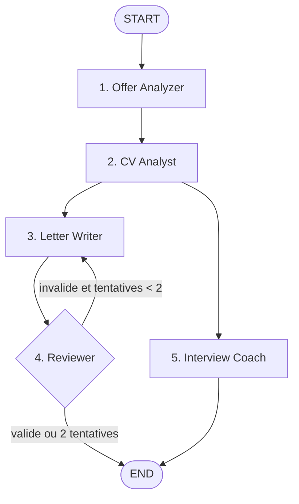

# alternance-copilot

Un copilote multi-agents qui prépare une candidature en alternance : il analyse l'offre, compare avec ton CV, rédige une lettre de motivation **sans rien inventer**, puis te prépare à l'entretien.

> Statut : 🚧 en construction. Voir [ROADMAP.md](ROADMAP.md).

## Le problème

Adapter un CV et une lettre à chaque offre prend du temps, et les outils génératifs ont tendance à **inventer des compétences** que le candidat n'a pas. Dans une vraie candidature, c'est un risque réel.

## La solution

Cinq agents orchestrés avec [LangGraph](https://langchain-ai.github.io/langgraph/) :

| # | Agent | Rôle |
|---|-------|------|
| 1 | Offer Analyzer | Extrait poste, missions, compétences, mots-clés de l'offre |
| 2 | CV Analyst | Score de correspondance, points forts, lacunes |
| 3 | Letter Writer | Rédige la lettre de motivation adaptée |
| 4 | Reviewer | Vérifie chaque affirmation de la lettre contre le CV |
| 5 | Interview Coach | Questions d'entretien et pistes de réponse |

Le **Reviewer** est le garde-fou du projet : si la lettre contient une affirmation non appuyée par le CV, elle repart au Writer (2 tentatives maximum).

## Architecture



Détails dans [ARCHITECTURE.md](ARCHITECTURE.md) et [AGENTS.md](AGENTS.md).

## Démarrage rapide

```bash
git clone https://github.com/<ton-compte>/alternance-copilot.git && cd alternance-copilot
pip install -e ".[dev]"
python -m alternance_copilot.graph
```

Variables d'environnement requises :

| Variable | Exemple |
|----------|---------|
| `LLM_MODEL` | `anthropic:<nom-du-modele>` ou `openai:<nom-du-modele>` |
| `ANTHROPIC_API_KEY` ou `OPENAI_API_KEY` | ta clé (ne jamais la commiter) |

## Structure du dépôt

```
alternance-copilot/
├── src/alternance_copilot/
│   ├── state.py          # état partagé + modèles Pydantic
│   ├── agents/           # un fichier par agent
│   ├── graph.py          # graphe LangGraph
│   └── api.py            # API FastAPI
├── frontend/             # Next.js (plus tard)
├── tests/                # pytest
├── evals/                # jeu d'évaluation
├── data/samples/         # fausses offres + faux CV uniquement
└── docs/
```

## Évaluation

Résultats à compléter dans [evals/README.md](evals/README.md).

## Confidentialité

- Seuls des **faux CV** sont versionnés dans `data/samples/`.
- Aucune clé API dans le dépôt (`.env` est ignoré par Git).

## Contribuer

Voir [CONTRIBUTING.md](CONTRIBUTING.md).

## Licence

À choisir (MIT recommandé pour un projet portfolio).
